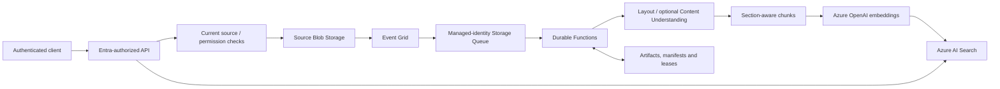

# Indexadillo

Versioned document ingestion and authenticated hybrid retrieval on Azure. Durable
Functions coordinates extraction, chunking, embeddings and Azure AI Search while
Blob Storage holds processing artifacts and recoverable document manifests.

The November 2026 modernization retains the custom push pipeline and adds source
version checks, document replacement/deletion, tenant and group authorization,
hybrid queries, authenticated citations, model profiles, bounded processing,
private-network production infrastructure and evaluation tooling.



## What changed

* **Secure API:** signed Entra access tokens, app roles and server-controlled source/
  index scope. Search applies tenant/group filters and revalidates source versions
  and permissions before returning text. Caller-supplied identity headers are not
  trusted. Citation downloads use the same authorization.
* **Correct document lifecycle:** full-path document identity; deterministic
  generation keys; recoverable pending manifests; obsolete-chunk removal; deletion
  and periodic reconciliation; stale/reordered events cannot simply replace the
  current source version.
* **Bounded durable processing:** history carries references, not document bodies,
  vectors or SAS tokens. Activities use content caches, resumable embedding batches,
  renewable leases and shared downstream concurrency limits.
* **Measured retrieval:** keyword/vector/hybrid modes with optional semantic reranking,
  preserved source spans, scalar/binary vector compression and labeled evaluation.
* **Model evolution:** one validated YAML profile coordinates extraction, chunking,
  embedding dimensions and index schema. The baseline remains
  `text-embedding-3-large`. Optional Azure v1 Responses metadata enrichment and
  GA Content Understanding are configurable and disabled by default.
* **Deployment separation:** runtime identities cannot administer Search schemas.
  CLI tools provision physical indexes, maintain a fingerprint registry, and record
  alias cutovers for rollback. Production defaults include private networking,
  ZRS, three Search replicas and zone-redundant Flex hosting.

Search replacement is not a multi-document transaction. The implementation and
tests do not establish a production SLA or live model-quality improvement. Review
[operations](docs/operations.md) for consistency, limits and recovery behavior.

## Local checks

Python 3.12 is used by the runtime, dev container and CI.

```sh
python3.12 -m venv .venv
. .venv/bin/activate
python -m pip install -r requirements-dev.txt
ruff check src scripts tests
ruff format --check src scripts tests
pytest
az bicep build --file infra/main.bicep --outfile /tmp/indexadillo.json
python scripts/check_infrastructure.py /tmp/indexadillo.json
```

The default suite uses mocked Azure boundaries and a bundled, checksum-verified
tokenizer vocabulary. It does not require Azure credentials or call a model.
`requirements.txt` files are resolved locks; direct dependencies live in the
corresponding `.in` files. Regenerate both locks together with `uv pip compile`.

## Get started on Azure

1. Configure an Entra API application and role assignments using
   [deployment.md](docs/deployment.md).
2. Select a compatible region and obtain the required model quota.
3. Activate the Python environment, authenticate Azure CLI/azd, create an azd
   environment, set `ENTRA_CLIENT_ID`, and run `azd up`.
4. Ensure the deployment identity has the scoped Search/schema and artifact data
   permissions needed by the postdeploy index provisioner.
5. Upload files to the `source` container beneath the configured tenant prefix.
6. Search or submit a reindex through the authenticated API.

```sh
az login
azd auth login
azd env new indexadillo-dev
azd env set ENTRA_CLIENT_ID YOUR_API_APPLICATION_CLIENT_ID
azd up
```

For local Functions debugging, copy `src/local.settings.example.json` to
`src/local.settings.json`, configure development Azure endpoints, start Azurite,
and run `func start` from `src`. Local auth bypass is explicit and rejected when
the app runs on Azure. Keep local settings untracked. The local source/AI services
still use Azure resources and your developer identity.

## API

All routes require an appropriate bearer token in deployed environments.

| Route | Role | Behavior |
|---|---|---|
| `POST /api/index` | Indexer | Bounded scoped job; HTTP 202 with `{id,statusUrl}` and Location |
| `GET /api/status/{id}` | Indexer | Scoped progress/results; protected history requires Operator |
| `GET /api/search?q=...` | Reader | Hybrid retrieval by default; bounded result count |
| `GET /api/document/{id}` | Reader | Source download after index and current-source authorization |
| `GET /api/orchestration_health` | Operator | Durable client health probe |

An Operator is authorized for every API role within their configured scope.
`GET /api/status` no longer enumerates every orchestration. Index/source selection
is constrained by `TENANT_SCOPES_JSON`, not trusted from a request body.

```json
{
  "prefix_list": ["YOUR-TENANT-PREFIX/contracts/"],
  "index_name": "documents-v2",
  "reconcile": true
}
```

An empty prefix `""` means the caller's configured tenant root. A Completed job
can contain failed documents; inspect the result counts and manifest ledger.

## Repository map

| Path | Purpose |
|---|---|
| `src/core/` | Authentication, profiles, storage/leases, extraction/model adapters, Search and lifecycle |
| `src/activities/`, `src/orchestrators/` | Durable activity boundaries and bounded orchestration |
| `src/profiles/` | Versioned processing profiles |
| `infra/` | Parameterized dev/prod resources, networking, scoped roles, events and monitoring |
| `scripts/manage_search.py` | Index administration, alias cutover and optional GA knowledge binding |
| `scripts/evaluation/` | Source-labeled retrieval evaluation |
| `tests/unit/` | Offline correctness and request-contract tests |
| `tests/e2e/` | Explicit live-Azure lifecycle checks |

Read [deployment](docs/deployment.md), [operations](docs/operations.md),
[evaluation](docs/evaluation.md) and [migration/rollback](docs/migration.md) before
production promotion. The GitHub live integration workflow runs only through an
explicit dispatch and provisions billable temporary resources. Production private
endpoints require a connected runner.

## License

[MIT](LICENSE.md). The bundled tokenizer vocabulary includes its own
[provenance notice](src/tokenizer/NOTICE.md).
